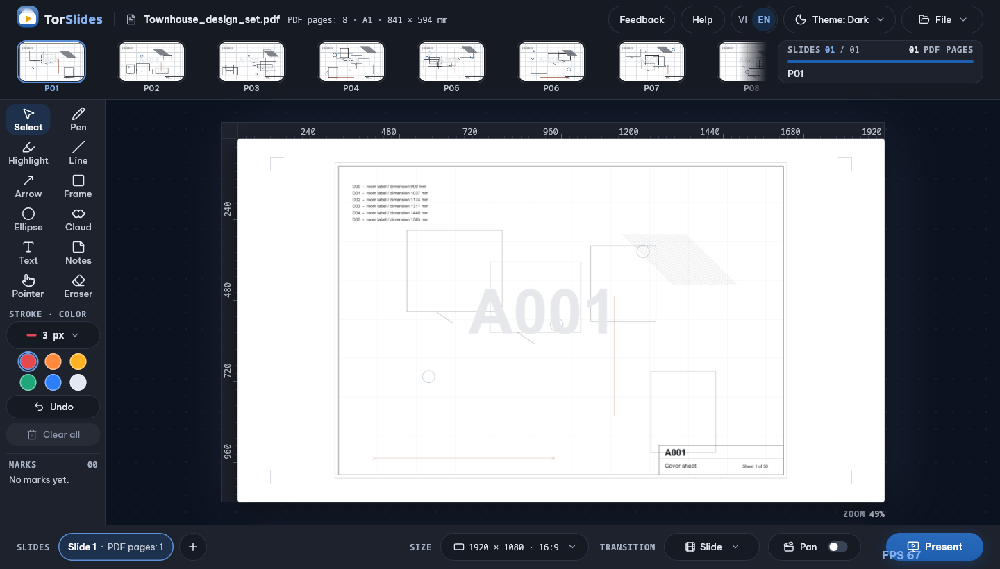

<h1 align="center">TorSlides</h1>

  
  
  
  

Turn a PDF drawing set into a presentation in minutes. Drag pages from your PDF onto slides,
crop and mark them up, then present full screen — no PowerPoint, no account, no internet.

- **Drag & drop PDF pages** onto slides, resize and crop — always re-rendered sharp from the original PDF.
- **Markup**: pen, highlight, line, arrow, frame, ellipse, cloud, text, notes.
- **Present** full screen with transitions (Slide, Zoom, Fade, Cube) and Ken Burns pan.
- **Export** to PDF, PNG or JPEG.
- **Portable & free** — unzip and run, nothing to install, your files stay on your computer.

## Download
Get the latest `TorSlides-…-portable-win64.zip` from [Releases](https://github.com/FelixNgH/TorSlides/releases/latest),
unzip, and run `torreader-slides.exe`. Windows 10/11, 64-bit.

## Feedback
Bugs and ideas: [TorReader Discord](https://discord.gg/GMQYM59rAt) → **#feedback-slides**.

More apps: [torreader.cloud](https://torreader.cloud) — TorReader PDF · TorSlides · TorVerse · TorReader 3D.

© B&B Creations. Free to use. Third-party components: [THIRD_PARTY_NOTICES.md](THIRD_PARTY_NOTICES.md) (PDFium BSD-3-Clause, Slint Royalty-Free — Made with Slint).
